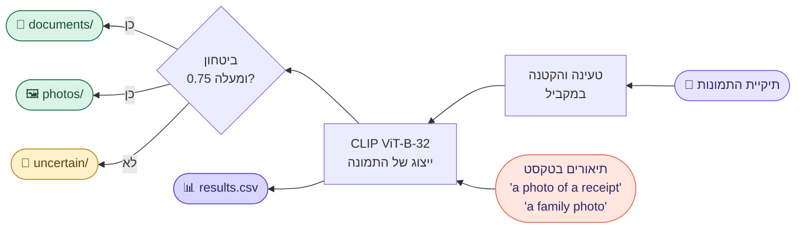

<div dir="rtl">

<p align="center">
  <a href="https://github.com/NoyaAdivi/sort-photos"></a>
</p>

<p align="center"><a href="README.md"></a></p>

<p align="center">
  <a href="#quick-start"></a>
  <a href="#how-it-works"></a>
  <a href="sort_photos.py"></a>
</p>

<p align="center">
  <a href="LICENSE"></a>
  <a href="https://github.com/NoyaAdivi/sort-photos/commits/main"></a>
  <a href="https://github.com/NoyaAdivi/sort-photos"></a>
  <a href="https://github.com/NoyaAdivi/sort-photos"></a>
</p>

<h3 align="center">מפרידים בין המסמכים לזכרונות, בלי לתייג אף תמונה.</h3>

<p align="center">
  Sort Photos עובר על אוסף תמונות גדול ומחלק אותו ל<b>מסמכים</b> (קבלות, דפים, צילומי מסך, פתקים, תעודות)<br>ול<b>תמונות</b> (אנשים, משפחה, מקומות, אוכל) בעזרת מודל <a href="https://github.com/mlfoundations/open_clip">CLIP</a> שלא צריך אימון.
</p>

<table align="center">
  <tr>
    <td align="center" width="25%"><a href="#how-it-works"><b>🧠 0</b></a><br><sub>תיוגים או אימון</sub></td>
    <td align="center" width="25%"><a href="#highlights"><b>🔒 100%</b></a><br><sub>בלי אינטרנט, פרטי</sub></td>
    <td align="center" width="25%"><a href="#output"><b>📁 3</b></a><br><sub>תיקיות פלט</sub></td>
    <td align="center" width="25%"><a href="#formats"><b>🖼️ 7</b></a><br><sub>פורמטים של תמונות</sub></td>
  </tr>
</table>

<a name="highlights"></a>
<p align="center"><a href="#highlights"></a></p>

<table>
  <tr valign="top">
    <td width="33%"><p><b>🧠 חכם בלי אימון</b></p><ul><li><b>Zero-shot:</b> כל תמונה מושווית לתיאורים קצרים בטקסט</li><li><b>סף ביטחון:</b> תמונות שהמודל לא בטוח בהן עוברות ל־<code>uncertain/</code></li><li><b>קל להרחבה:</b> מוסיפים תיאור או תיקייה חדשה שלמה</li></ul></td>
    <td width="33%"><p><b>🔒 בטוח לתמונות שלך</b></p><ul><li><b>עובד בלי אינטרנט</b> אחרי ההורדה הראשונה של המודל</li><li><b>מעתיק ולא מזיז</b> כברירת מחדל, התיקייה המקורית לא משתנה</li><li><b>אפשר להמשיך:</b> עוצרים עם Ctrl+C ומריצים שוב</li></ul></td>
    <td width="33%"><p><b>⚡ מהיר גם במחשב ישן</b></p><ul><li><b>קוונטיזציה ל־int8</b> לפי 1.5 עד 2 מהירות במעבד</li><li><b>פענוח JPEG מהיר</b> וטעינה במקביל</li><li><b>הרצת ניסיון</b> על מדגם כדי לבדוק תוצאות ומהירות</li></ul></td>
  </tr>
</table>

<a name="how-it-works"></a>
<p align="center"><a href="#how-it-works"></a></p>



כל תמונה מקבלת ציון מול שתי קבוצות של תיאורים בטקסט, והקבוצה עם ההסתברות הכוללת הגבוהה ביותר מנצחת. מתחת לסף (0.75 כברירת מחדל) התמונה עוברת ל־<code>uncertain/</code> לבדיקה מהירה ביד.

<a name="output"></a>
<details open>
<summary><b>📁 מה מקבלים בסוף</b></summary>

```
Sorted/
├── documents/    מבנה תתי התיקיות המקורי נשמר
├── photos/
├── uncertain/    תמונות עם ביטחון נמוך, כדאי לעבור עליהן ביד
└── results.csv   שורה לכל תמונה: קטגוריה, ביטחון, ציונים, נתיב היעד
```
קבצים פגומים או כאלה שלא נפתחים נרשמים כ־<code>error</code> ב־<code>results.csv</code> ולא מועתקים.
</details>

<a name="tech-stack"></a>
<p align="center"><a href="#tech-stack"></a></p>

<p align="center">
  <a href="https://www.python.org"></a>
  <a href="https://pytorch.org"></a>
  <a href="https://github.com/mlfoundations/open_clip"></a>
  <a href="https://python-pillow.org"></a>
  <a href="https://pandas.pydata.org"></a>
</p>

<a name="quick-start"></a>
<p align="center"><a href="#quick-start"></a></p>

צריך **Python 3.9 ומעלה**. הקובץ [`requirements.txt`](requirements.txt) מתקין את הגרסה הקטנה של PyTorch למעבד בלבד. עם כרטיס NVIDIA, מתקינים קודם את PyTorch מ־[pytorch.org](https://pytorch.org/get-started/locally/).

```bash
pip install -r requirements.txt
```

1. **הרצת ניסיון על 300 תמונות** (מסווג וכותב `results.csv`, לא מעתיק כלום):
   ```bash
   python sort_photos.py "D:\Pictures" "D:\Sorted" --dry-run --limit 300
   ```
2. **בודקים** את `D:\Sorted\results.csv` ואז מוחקים אותו.
3. **ממיינים הכול:**
   ```bash
   python sort_photos.py "D:\Pictures" "D:\Sorted"
   ```

> [!NOTE]
> תיקיית הפלט לא יכולה להיות בתוך תיקיית המקור. בהרצה הראשונה המודל יורד (בערך 600 MB).

<details>
<summary><b>⚙️ כל האפשרויות</b></summary>

| אפשרות | מה היא עושה |
| --- | --- |
| `--dry-run` | רק מסווג וכותב `results.csv`, בלי להעתיק או להזיז |
| `--limit N` | מטפל רק ב־N התמונות החדשות הראשונות |
| `--threshold X` | ביטחון מינימלי להחלטה (ברירת מחדל `0.75`) |
| `--move` | מזיז קבצים במקום להעתיק |
| `--batch-size N` | תמונות בכל קבוצה (ברירת מחדל `32`), להוריד אם נגמר הזיכרון |
| `--no-quantize` | מבטל את ההאצה של int8 |
| `--workers N` | תהליכונים לטעינת תמונות (ברירת מחדל: מספר הליבות) |
| `--threads N` | תהליכונים של PyTorch (ברירת מחדל: כל הליבות) |
</details>

<details>
<summary><b>🎯 איך לשפר את הדיוק</b></summary>

עורכים את המילון `CATEGORIES` בראש הקובץ [`sort_photos.py`](sort_photos.py). אם סוג מסוים של תמונה ממשיך להגיע למקום הלא נכון, מוסיפים לקבוצה הנכונה תיאור שמתאר אותו, למשל `"a photo of a medical prescription"` תחת `documents`. קבוצה חדשה, כמו `"screenshots"`, מקבלת תיקיית פלט משלה אוטומטית.
</details>

<a name="formats"></a>
<details>
<summary><b>🖼️ פורמטים ומהירות</b></summary>

JPG, PNG, BMP, WEBP, TIFF, GIF ו־HEIC/HEIF (דרך `pillow-heif`). במחשב נייד ישן עם 2 עד 4 ליבות, 40,000 תמונות לוקחות בערך 30 עד 90 דקות. סרגל ההתקדמות מראה כמה תמונות בשנייה.
</details>

<a name="contact"></a>
<p align="center"><a href="#contact"></a></p>

<p align="center">
  <a href="https://github.com/NoyaAdivi/sort-photos"></a>
  <a href="https://www.linkedin.com/in/noya-adivi/"></a>
  <a href="https://noyaadivi.github.io/noya-website"></a>
  <a href="https://github.com/NoyaAdivi"></a>
</p>

</div>
