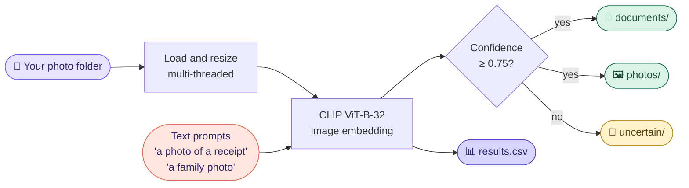

<p align="center">
  <a href="https://github.com/NoyaAdivi/sort-photos"></a>
</p>

<p align="center"><a href="README.he.md"></a></p>

<p align="center">
  <a href="#quick-start"></a>
  <a href="#how-it-works"></a>
  <a href="sort_photos.py"></a>
</p>

<p align="center">
  <a href="LICENSE"></a>
  <a href="https://github.com/NoyaAdivi/sort-photos/commits/main"></a>
  <a href="https://github.com/NoyaAdivi/sort-photos"></a>
  <a href="https://github.com/NoyaAdivi/sort-photos"></a>
</p>

<h3 align="center">Separate your documents from your memories, without labeling a single photo.</h3>

<p align="center">
  Sort Photos goes through a big photo collection and splits it into <b>documents</b> (receipts, papers, screenshots, notes, IDs)<br>and <b>photos</b> (people, family, places, food) with a zero-shot <a href="https://github.com/mlfoundations/open_clip">CLIP</a> model.
</p>

<table align="center">
  <tr>
    <td align="center" width="25%"><a href="#how-it-works"><b>🧠 0</b></a><br><sub>labels or training</sub></td>
    <td align="center" width="25%"><a href="#highlights"><b>🔒 100%</b></a><br><sub>offline, private</sub></td>
    <td align="center" width="25%"><a href="#output"><b>📁 3</b></a><br><sub>output folders</sub></td>
    <td align="center" width="25%"><a href="#formats"><b>🖼️ 7</b></a><br><sub>image formats</sub></td>
  </tr>
</table>

<a name="highlights"></a>
<p align="center"><a href="#highlights"></a></p>

<table>
  <tr valign="top">
    <td width="33%"><p><b>🧠 Smart without training</b></p><ul><li><b>Zero-shot:</b> each image is compared to short text prompts</li><li><b>Confidence threshold:</b> unsure images go to <code>uncertain/</code></li><li><b>Easy to extend:</b> add a prompt or a whole new folder</li></ul></td>
    <td width="33%"><p><b>🔒 Safe for your photos</b></p><ul><li><b>Runs offline</b> after the first model download</li><li><b>Copies, never moves</b> by default; the source stays untouched</li><li><b>Resumable:</b> stop with Ctrl+C and run again to continue</li></ul></td>
    <td width="33%"><p><b>⚡ Fast on old laptops</b></p><ul><li><b>int8 quantization</b> for about 1.5-2x speed on CPU</li><li><b>Fast JPEG decoding</b> and multi-threaded loading</li><li><b>Dry run</b> on a sample to check results and speed</li></ul></td>
  </tr>
</table>

<a name="how-it-works"></a>
<p align="center"><a href="#how-it-works"></a></p>



Each image is scored against two groups of text prompts. The group with the highest total probability wins. Below the threshold (0.75 by default), the image goes to <code>uncertain/</code> for a quick manual check.

<a name="output"></a>
<details open>
<summary><b>📁 Output</b></summary>

```
Sorted/
├── documents/    original sub-folder structure is kept
├── photos/
├── uncertain/    low-confidence images, review these by hand
└── results.csv   one row per image: category, confidence, scores, target path
```
Corrupt or unreadable files are logged as <code>error</code> in <code>results.csv</code> and are not copied.
</details>

<a name="tech-stack"></a>
<p align="center"><a href="#tech-stack"></a></p>

<p align="center">
  <a href="https://www.python.org"></a>
  <a href="https://pytorch.org"></a>
  <a href="https://github.com/mlfoundations/open_clip"></a>
  <a href="https://python-pillow.org"></a>
  <a href="https://pandas.pydata.org"></a>
</p>

<a name="quick-start"></a>
<p align="center"><a href="#quick-start"></a></p>

Requires **Python 3.9+**. [`requirements.txt`](requirements.txt) installs the small CPU-only build of PyTorch. With an NVIDIA GPU, install PyTorch from [pytorch.org](https://pytorch.org/get-started/locally/) first.

```bash
pip install -r requirements.txt
```

1. **Dry run on 300 images** (classifies and writes `results.csv`, copies nothing):
   ```bash
   python sort_photos.py "D:\Pictures" "D:\Sorted" --dry-run --limit 300
   ```
2. **Check** `D:\Sorted\results.csv`, then delete it.
3. **Sort everything:**
   ```bash
   python sort_photos.py "D:\Pictures" "D:\Sorted"
   ```

> [!NOTE]
> The output folder must not be inside the source folder. The first run downloads the model (about 600 MB).

<details>
<summary><b>⚙️ All options</b></summary>

| Option | Description |
| --- | --- |
| `--dry-run` | Classify only and write `results.csv`; don't copy or move anything |
| `--limit N` | Process only the first N new images |
| `--threshold X` | Minimum confidence for a decision (default `0.75`) |
| `--move` | Move files instead of copying them |
| `--batch-size N` | Images per batch (default `32`); lower it if memory runs out |
| `--no-quantize` | Disable the int8 speed-up |
| `--workers N` | Threads for loading images (default: CPU cores) |
| `--threads N` | CPU threads for PyTorch (default: all cores) |
</details>

<details>
<summary><b>🎯 Improving accuracy</b></summary>

Edit the `CATEGORIES` dictionary at the top of [`sort_photos.py`](sort_photos.py). If a kind of image keeps landing in the wrong place, add a prompt that describes it to the right group, for example `"a photo of a medical prescription"` under `documents`. A new group, such as `"screenshots"`, gets its own output folder automatically.
</details>

<a name="formats"></a>
<details>
<summary><b>🖼️ Formats and speed</b></summary>

JPG, PNG, BMP, WEBP, TIFF, GIF and HEIC/HEIF (through `pillow-heif`). On an older 2-4 core laptop, expect roughly 30-90 minutes for 40,000 images; the progress bar shows images per second.
</details>

<a name="contact"></a>
<p align="center"><a href="#contact"></a></p>

<p align="center">
  <a href="https://github.com/NoyaAdivi/sort-photos"></a>
  <a href="https://www.linkedin.com/in/noya-adivi/"></a>
  <a href="https://noyaadivi.github.io/noya-website"></a>
  <a href="https://github.com/NoyaAdivi"></a>
</p>
